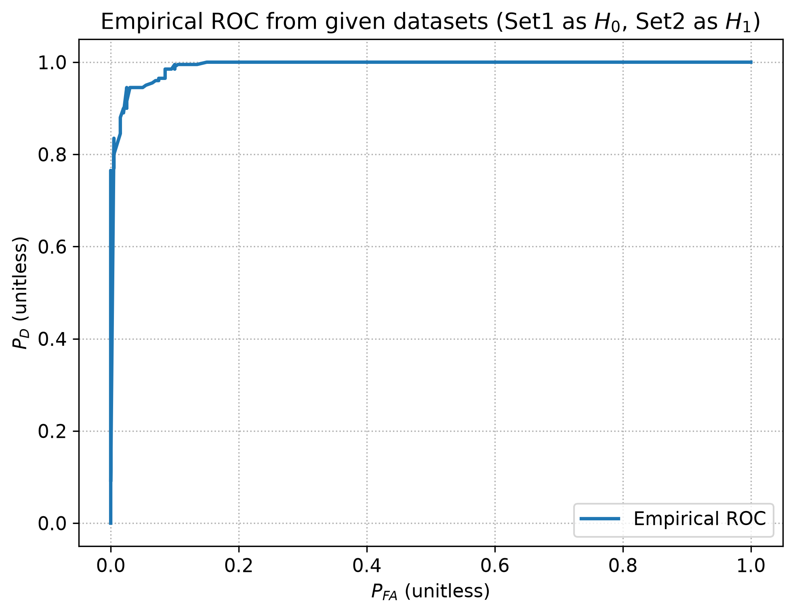
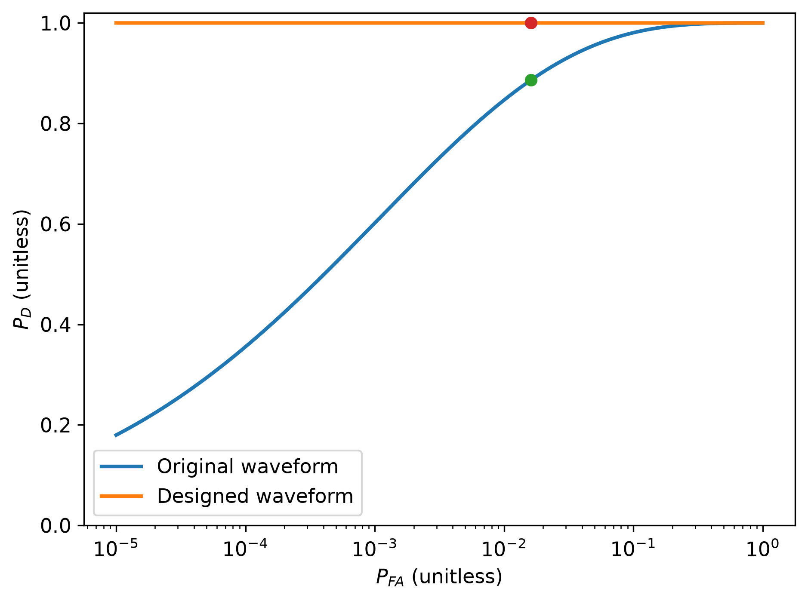
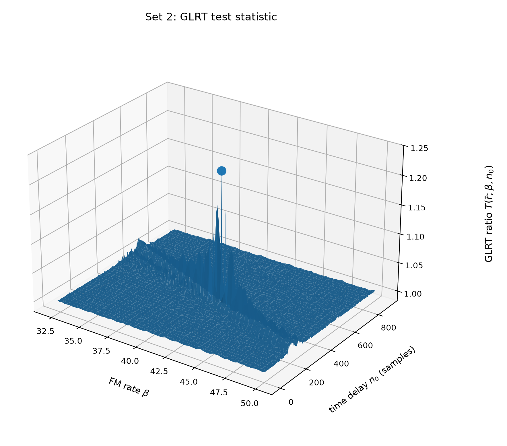

# Underwater Acoustic Signal Detection & Estimation

Two Arizona State University EEE 556 studies by **Ganeshkumar Marimuthu**, turning noisy underwater acoustic recordings into interpretable detection scores and signal-parameter estimates.

**Study 1:** matched filtering, ROC analysis, correlated noise and fixed-energy waveform optimization.  
**Study 2:** generalized likelihood ratio testing (GLRT), maximum likelihood estimation (MLE) and sinusoidal jammer suppression.

[Data Scientist portfolio](https://mganesh.notion.site/) · [LinkedIn](https://www.linkedin.com/in/mganesh-ds/)

## The two studies

| Study | Question and methods | Evidence |
|---|---|---|
| [1 — Detection, ROC and waveform optimization](docs/study-1.md) | Detect a known HFM template under white/correlated Gaussian noise using matched filters, analytical/empirical ROC, Monte Carlo/bootstrap evaluation and covariance eigendecomposition. | Correlated-noise detection probability: **0.886246 theoretical / 0.88 empirical**. Fixed-energy waveform optimization: **13.1667× deflection gain**. |
| [2 — GLRT, MLE and jammer suppression](docs/study-2.md) | Estimate unknown delay, FM rate, amplitude and phase using least squares and grid search; fit and suppress sinusoidal interference. | GLRT peaks: **1.009281 / 1.233437**. Original jammer cases: **6.42× peak-score separation** and **0-sample delay error in the evaluated recovery case**. |

The 13.1667× figure measures a deflection term, and 6.42× compares GLRT peak scores. Neither is classification accuracy or a general performance guarantee.

## Code and validation

Full existing Python implementations are included for both studies, with small portability changes to input paths and loader resolution. Numerical analysis functions are preserved. Study 2 uses recovered earlier versions because the final submission files were skipped by the OneDrive export.

- All **five Study 1 programs** ran successfully on the four supplied datasets; the values above matched the original report.
- The **Study 2 GLRT/MLE program** reproduced the two peak scores, target delay of 371 samples, amplitude 1.371551 and phase 0.639725 rad.
- The **jammer implementation** passed a deterministic synthetic target/interference check. Its original Sets 3 and 4 were absent from the export, so the original jammer metrics have not been rerun.

See [provenance and validation](docs/provenance.md) and the [source manifest](docs/source-manifest.json) for source paths, hashes, adaptations and limits. Course datasets are not distributed. Set labels are local to each study.

## Repository layout

```text
study1/
  white_noise_detection.py       Matched filter and bootstrap false alarms
  roc_analysis.py                Analytical and empirical ROC
  correlated_noise_detection.py  Covariance-aware generalized matched filter
  waveform_optimization.py       Fixed-energy waveform design
  data_validation.py             Paired-data/template checks
study2/
  glrt_mle.py                     HFM delay/FM search and closed-form MLE
  jammer_glrt.py                  Jammer fitting, suppression and recovery
uuv_loader.py                    Original MAT/download helper
uuv_loader_set34.py              Correlated-noise data loader
examples/                        Local MAT inspection and MAT-to-CSV conversion
docs/                            Both studies, code highlights and provenance
assets/                          Selected regenerated figures
```

## Quick start

Run commands from the repository root. Use Python 3.10 or newer.

```bash
python3 -m venv .venv
source .venv/bin/activate
python -m pip install -r requirements.txt
```

### Study 1

Place `UUV_Set1.mat` through `UUV_Set4.mat` in `data/study1/`. Expected shape: **1024 samples × 200 channels**, or its transpose.

```bash
MPLBACKEND=Agg python study1/data_validation.py --no_plots --out_dir results/data-check
MPLBACKEND=Agg python study1/white_noise_detection.py --no_inline --out_dir results/white
MPLBACKEND=Agg python study1/roc_analysis.py --no_inline --out_dir results/roc
MPLBACKEND=Agg python study1/correlated_noise_detection.py --no_inline --out_dir results/correlated
MPLBACKEND=Agg python study1/waveform_optimization.py --no_inline --out_dir results/waveform
```

Use `--help` for parameter overrides. Dataset defaults use local files and the bundled loaders. Optional URL support remains for user-supplied inputs.

### Study 2

The scripts read headerless CSV files in `data/study2/`:

| Inputs | Shape | Program |
|---|---|---|
| `Threat_Detection_Set1.csv`, `Threat_Detection_Set2.csv` | 2101 × 40 | `glrt_mle.py` |
| `Threat_Detection_Set3.csv`, `Threat_Detection_Set4.csv` | 2001 × 40 | `jammer_glrt.py` |

Convert corresponding MATLAB files if needed:

```bash
python examples/prepare_study2_csv.py /path/to/Threat_Detection_Set1.mat /path/to/Threat_Detection_Set2.mat
MPLBACKEND=Agg python study2/glrt_mle.py
MPLBACKEND=Agg python study2/jammer_glrt.py
```

The jammer command additionally needs Sets 3 and 4. Results go to `results/study2/`. Set `UUV_DATA_DIR` and `UUV_OUTPUT_DIR` to use different directories. Full parameter grids can take several minutes.

For a quick data-loading check:

```bash
python examples/inspect_mat.py data/study1/UUV_Set1.mat --samples 1024 --channels 200
```

## Selected results

Regenerated with the recovered code and the author's supplied input files.







## Data science skills

Statistical hypothesis testing · ROC/false-alarm analysis · Covariance modeling · Maximum likelihood estimation · Least squares · Numerical linear algebra · Parameter search · Monte Carlo/bootstrap evaluation · Residual diagnostics · Scientific visualization

## Original studies and interpretation

1. [UUV Mine Detection, ROC Analytics & Waveform Optimization](https://mganesh.notion.site/33818c605907812c8268c7ea63da699a)
2. [Jammer-Resilient Underwater Threat Detection — GLRT, MLE & Signal Recovery](https://mganesh.notion.site/3c018c60590781c2b5f6cb2084acb416)

These academic analyses use supplied acoustic observations. Study 1 includes paired noise/signal datasets rather than independent field validation. Study 2's GLRT comparisons and recovery errors describe evaluated cases; they do not establish calibrated operational thresholds, field accuracy or real-time deployment.
